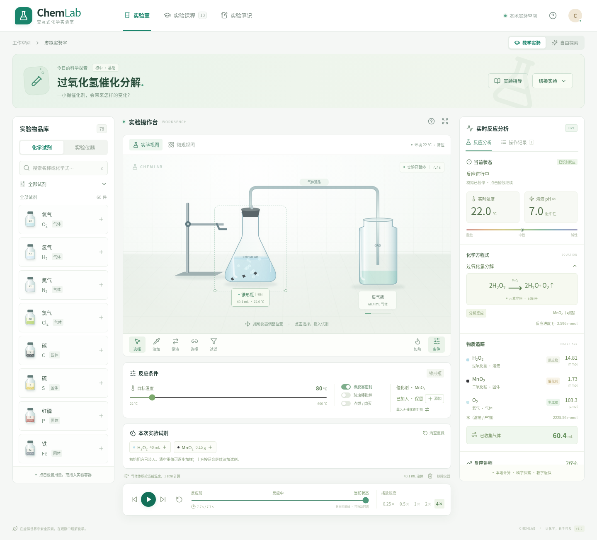

# ChemLab · 交互式虚拟化学实验室

一个可以在本地运行的初高中虚拟化学实验台。采用 React 19、TypeScript、Vite、Zustand、SVG、Canvas 2D、CSS 动画和 Vitest。无需后端、账号、API Key 或公网部署；运行时无需访问第三方字体或动画服务。



[微观模式截图](docs/screenshots/microscope.png) · [本地验收记录](docs/validation.md)

## 安装与启动

需要 **Node.js 22+（推荐 24）**、npm 和现代浏览器（推荐 Chrome / Edge）。

```bash
git clone https://github.com/oi789113/chemistry.git
cd chemistry
npm ci
npm run dev
```

打开终端显示的地址，默认 **http://localhost:5173**。开发服务监听 `0.0.0.0`，仅用于本地/受信任网络开发。

```bash
npm test           # 化学引擎、微观守恒、历史与交互状态单元测试
npm run build     # TypeScript 严格检查，构建到 dist/
npm run preview   # 本地预览构建（默认 http://localhost:4173）
npm run test:e2e   # Chromium 浏览器验收
```

首次运行浏览器测试，若没有系统 Chromium：

```bash
npx playwright install chromium
npm run test:e2e
```

Linux 默认优先使用 `/usr/bin/chromium`；也可通过 `PLAYWRIGHT_CHROMIUM_EXECUTABLE_PATH` 指定浏览器路径。Playwright 会自动启动或复用本地 Vite 服务。

## 已实现

- **60 种物质**：中文名称、化学式、类别、颜色/状态、性质、摩尔质量、条件与安全信息；可搜索中文或化学式（支持下标输入），查看相关反应。
- **18 类 SVG 仪器**：烧杯、试管、锥形瓶、圆底烧瓶、集气瓶、酒精灯、滴管、玻璃棒、漏斗、导管、水槽、铁架台、量筒、温度计、蒸发皿、坩埚、试管夹与橡胶塞。
- **14 条守恒反应规则**，由实际反应物、相态、用量、浓度、温度、点燃、空气与催化剂状态驱动。未知组合明确提示暂未支持。
- **10 个教学实验**及自由实验；每个实验可装载初始配方，也可清空后逐步加样。
- Canvas 气泡、沉淀、晶体，与物质生成量和时钟联动；SVG 透明玻璃、液面与浓度/酸碱颜色；动态加热火焰与镁燃烧柔化白光。
- 可拖动仪器、定量加样、0.5 mL 滴加、倒液、过滤、加热、搅拌、密封与连接集气瓶。
- 实时配平方程式、反应类型、条件、催化剂、物质账本、温度、近似 pH、速率曲线、气体体积和现象原理。
- 0.25× / 0.5× / 1× / 2× / 4× 播放、暂停、重置、实际状态时间轴及历史回放。
- 微观原子/分子/离子与键变化示意，包含旁观离子和催化剂说明。
- 实验笔记在浏览器保存；可导出 JSON 物质账本、初始/当前状态、操作日志和笔记。

## 操作指南

1. 默认打开「过氧化氢催化分解」，初始试剂已装入并连接集气瓶。点击底部播放键（或空格）观察气泡与氧气收集。
2. 点击 **切换实验** 选择课程；**实验指导** 中查看步骤。**自由探索** 打开空烧杯。
3. 从左侧拖入仪器；点击或拖入试剂会打开用量/浓度设置。所有加样和条件控制作用于当前选中的容器。
4. **滴加** 切换为每次 0.5 mL；**倒液** 先选源容器，再点接收容器，转移 50%；**过滤** 需要先添加漏斗，转移全部滤液。
5. **连接** 先给发生容器安装橡胶塞，再选集气瓶。未密封的气体会逸出，满瓶后的多余气体计入环境账本。
6. **目标温度** 只设定目标，还需要开启 **加热**。含水容器近似不超过 100 °C；高锰酸钾需干燥固体达到 200 °C。镁条需点击 **点燃 / 熄灭**。
7. 铁架台/试管夹可固定或解除固定；玻璃棒切换搅拌；温度计读取温度。点击现有工具作用于所选容器。
8. 酸碱中和、酚酞实验先装入碱与指示剂；点击 HCl 配方按钮或用滴管加酸，观察粉红色消失。
9. 分离实验先搅拌使 NaCl 溶解，再过滤到蒸发皿，选中蒸发皿设定 120 °C 并加热，观察水位下降和析晶。
10. 拖动时间轴暂停并还原历史状态。点击播放继续回放；从历史时刻修改条件会建立新分支。最多保留最近约 10 分钟快照，刷新页面会清空实验状态；笔记文本保留。

## 教学实验

| 实验               | 可观察的关键变化                     |
| ------------------ | ------------------------------------ |
| 高锰酸钾加热制氧气 | 达到温度后分解产氧与固相变化         |
| 过氧化氢催化分解   | 催化前后速率对比；MnO₂ 保留          |
| 碳酸钙与盐酸制 CO₂ | 白色固体减少、二氧化碳气泡           |
| 锌与稀硫酸制氢气   | 金属消耗与氢气收集                   |
| 硫酸铜与氢氧化钠   | 蓝色 Cu(OH)₂ 絮状沉淀、沉降          |
| 铁与硫酸铜         | 铜析出，蓝色向浅绿色变化             |
| 酸碱中和           | pH、指示剂与温度变化                 |
| 酚酞指示           | 碱中显粉红、滴加酸后褪色             |
| 镁条燃烧           | 点燃、氧气消耗、白光与 MgO           |
| 过滤、蒸发与结晶   | 溶解、固液分离、水位下降与 NaCl 析晶 |

## 科学模型与边界

这是**教学近似**，不是通用化学预测系统。收录物质不意味着其所有反应均已实现。反应速率是便于观察的参数，蒸发采用时间压缩。只支持 NaCl 的定量溶解/结晶；pH、传热、空气供氧和集气采用简化模型。微观键变化不代表真实反应路径。未实现密闭压力、危险事件、全部副反应与复杂平衡。水槽目前是液体容器，排水集气尚未实现。

配平规则、单位、环境账本、假设、限制和扩展方法详见 [docs/chemistry-model.md](docs/chemistry-model.md)。请勿根据虚拟结果自行进行危险真实实验。

## 目录

```text
src/
  chemistry/    化学式解析、计量与固定步长引擎、守恒的微观模型
  data/         物质数据库、仪器定义、配平规则、10 个教学配方
  store/        Zustand 操作、固定时钟、快照与历史分支
  visuals/      SVG 仪器、Canvas 气泡/沉淀/结晶、微观视图
  components/   库、实验台、分析、方程式、时间轴、无障碍弹窗
  App.tsx       课程选择、教学引导、实验笔记与报告导出
  styles.css    2.5D 实验室布局、玻璃、火焰、响应式样式
public/         本地 SVG 站点图标（仪器/动画均为源代码）
tests/          科学规则、状态测试与 Playwright 交互验收
docs/           化学模型说明
```

## 后续部署

本项目为静态前端，`npm run build` 后的 `dist/` 可托管到任意支持静态文件的平台。GitHub Actions 会将 main 分支构建并发布到 GitHub Pages。
