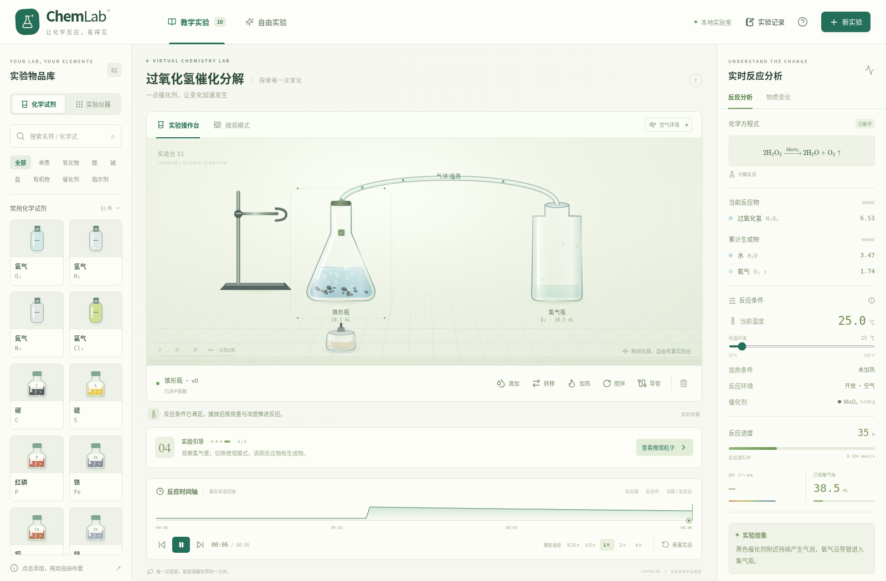

# ChemLab · 让化学反应，看得见

面向初高中教学的交互式虚拟化学实验室。React、TypeScript、Vite、Zustand、SVG、Canvas 2D 和 KaTeX；有玻璃质感的仪器、随物质量变化的粒子，以及可恢复实际状态的时间轴。无服务端、账户、API Key 或外部图片依赖。

**交付分支：[`codex/chemlab-interactive`](https://github.com/oi789113/chemistry/tree/codex/chemlab-interactive)**。开发期间 `main` 出现了另一份独立实现，本分支保留阶段提交，不覆盖 `main` 的已有工作。请使用下面的分支克隆命令。



## 本地运行

需要 Node.js 22.12+（推荐 24 LTS）。

```sh
git clone --branch codex/chemlab-interactive https://github.com/oi789113/chemistry.git
cd chemistry
npm ci
npm run dev
```

打开终端显示的本地地址（默认 http://localhost:5173）。

```sh
npm test              # 33 项化学引擎、守恒、十个实验及状态测试
npm run check         # TypeScript 严格检查 + Vitest
npm run build         # 生产构建，输出 dist/
npm run preview       # 本地预览构建产物
npm run format:check  # 格式检查
```

浏览器验收：

```sh
npx playwright install chromium
npm run test:e2e
```

已有 Chromium 的 Linux 环境可使用 `PLAYWRIGHT_CHROMIUM_EXECUTABLE_PATH=/usr/bin/chromium npm run test:e2e`。GitHub Actions 会自动运行测试、构建与浏览器验收。安装依赖需要网络；运行期的脚本、字体与图形都由本地构建提供。

## 已实现功能

**61 种物质、18 条配平规则、18 类仪器、10 个可操作教学实验**，并支持自由混合与条件判断。

| 教学实验           | 交互与现象                                          |
| ------------------ | --------------------------------------------------- |
| 高锰酸钾加热制氧气 | 固定试管、连接导管、升温、固体分解、集气、断管熄灯  |
| 过氧化氢催化分解   | 比较催化前后、改变催化剂负载、气泡与氧气收集        |
| 碳酸钙与盐酸制 CO₂ | 调整用量与浓度、限制反应物、固体减少与气泡          |
| 锌与稀硫酸制 H₂    | 稀酸浓度校验、金属消耗、置换、集气                  |
| 硫酸铜与 NaOH      | Cu(OH)₂ 细颗粒生成、聚集、下沉、搅拌悬浮            |
| 铁与硫酸铜         | 铁消耗、铜析出、蓝色溶液变浅绿色                    |
| 酸碱中和           | 温升、强酸强碱 pH、酚酞颜色与离子方程式             |
| 酚酞指示实验       | 每滴 0.05 mL 的酸碱滴加、可逆显色、指示剂保留       |
| 镁条燃烧           | 固定坩埚、加热点燃、白光、MgO 生成、环境供氧账本    |
| 过滤、蒸发与结晶   | 加水、搅拌溶解 NaCl、保留砂粒、过滤、液面下降、析晶 |

其他规则包括氯化银、硫酸钡、氢氧化铁沉淀、碳酸盐与酸、氧化铜与酸、生石灰水合、硫酸中和、氯酸钾分解。物质被收录不代表其所有反应都已实现。

## 操作

- **物品与拖动**：点击仪器自动放置；从库拖入可指定位置。台上仪器可拖动，聚焦后可用方向键微调；容器选择框可选中被遮挡的容器。
- **添加试剂**：按名称或化学式搜索（支持下标），点击或拖入容器，设置物态、g / mL 用量与 mol/L 浓度。水溶液同时记录溶剂水。
- **滴加**：选择溶液，每滴 0.05 mL，并显示一次液滴操作动画。
- **倾倒与过滤**：选源容器，打开“转移”，选择目标与比例。过滤需漏斗，溶液转入接收容器，不溶物留作滤渣。
- **加热**：放置酒精灯；试管、圆底烧瓶、坩埚需先点击铁架台或夹具固定。量筒和集气瓶不直接加热；无导气通路的密闭容器禁止直接加热。
- **集气**：选发生容器，放置导管与集气瓶后点击“导管”。绿色填充表示累计气体体积，不表示气体有色。水槽预装 250 mL 清水；连接后点击水槽即可充瓶并启用排水集气，水量与收集体积联动。未实现流体力学或气体溶解损失。
- **微观模式**：分子、离子、催化表面区域与键重组 / 电子转移示意。粒子是当前物质的抽样，不是分子动力学。
- **时间轴**：0.25×、0.5×、1×、2×、4×。只能到达已计算的时刻，拖动会暂停并恢复数量、条件、催化剂和引导进度。直接播放重放已有状态；修改过去会截断旧未来并重新计算。
- **记录**：可下载当前快照、单位、物质与环境账本、操作日志的 JSON。当前版本不导入记录；刷新会开始新实验。

快捷键：`Space` 播放 / 暂停、`M` 微观模式、`R` 重置；聚焦仪器后使用方向键，`Shift` + 方向键加大步长，`Delete` 移除聚焦的空仪器。对话框支持 Tab 焦点循环和 Esc 关闭。

## 开发结构

- `src/chemistry/`：物质与仪器库、反应规则、十个实验配方、公式解析、按 mmol 计算的纯模拟引擎及测试。
- `src/components/`：SVG 仪器、Canvas 液体与粒子、微观与键变化、操作、KaTeX 方程式和实时分析界面。
- `src/store/`：Zustand 实验操作、快照、播放、回放分支与记录导出。
- `public/`：项目自有静态资源。
- `e2e/`：浏览器操作验收。
- `docs/`：模型范围、化学近似与操作说明。
- `.github/workflows/ci.yml`：检查流程，不含部署。

## 化学模型原则

方程式通过元素和摩尔质量校验。用量、物态、浓度、温度、催化剂和开放 / 密闭环境参与规则判断。按限制反应物计算反应进度，催化剂不消耗，气体收集、逸散、蒸发和空气供氧均有数量记录。未支持的体系不推测生成物。

反应速度、色彩、pH 和粒子运动是教学近似，不是实验室预测。详细范围见 [化学模型与边界](docs/chemistry-model.md)、[操作与扩展](docs/development.md)、[验证记录](docs/verification.md)。

所有实验视觉由项目自身 SVG、Canvas 和 CSS 生成，不使用 GIF、视频或静态反应图片冒充模拟。构建产物可用于后续静态部署；本阶段没有公网部署、域名、登录、社交或付费功能。虚拟实验不可作为实际危险化学操作的指导。
